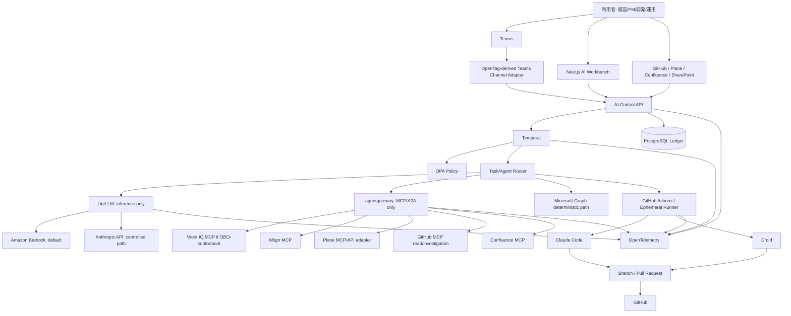

# 目標アーキテクチャ

## 論理構成



## アーキテクチャ上の境界

### Control Plane

Temporalは業務処理の状態、timer、retry、approval、compensationを保持する。Hono serverは認証、request validation、webhook ingress、Temporal start/signal/query、read model APIに限定する。

### Inference Plane

LiteLLMだけがBedrock/Anthropicへ接続する。application、Web、Claude Code、Droidは論理model aliasとVirtual Keyだけを知る。

### Access Plane

agentgatewayだけがMCP/A2A serverを公開する。ToolをControl API、Claude/Droid、Workbenchへ直接ばらまかない。

### M365 Plane

Work IQはdelegated user intelligence。Graphはsystem integration。Work IQとGraphを一つのgeneric clientに統合しない。

### User Surface

Teams adapterとWeb Workbenchは交換可能なpresentation layer。workflow state、policy、SoR logicを持たない。

## 既存14エージェントの移行

既存PrjOps/DevOps agentは廃止せず、次の形へ変換する。

```text
現行 agents/*.ts
  ├─ deterministic decision -> 既存libをそのまま利用
  ├─ external read/write -> Temporal Activity + integration adapter
  ├─ LLM call -> LiteLLM adapter
  ├─ long wait/retry -> Temporal Workflow
  └─ user approval -> Approval child workflow / signal
```

Agent名は業務能力として維持してよいが、各agentが独自loop、独自DB state、独自provider keyを持つ構成は廃止する。
