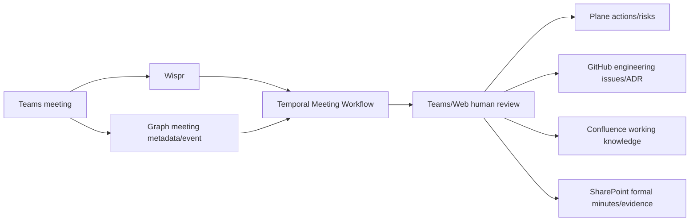

# Knowledge / Meeting Architecture

## 情報の流れ

## Wisprの位置付け

- capture/transcription/summary/action candidate。
- MCPはread-only利用をbaseline。
- 正式議事録・法的録画の唯一の正本にしない。
- meeting note availability eventが提供されない場合、Graph calendar end + bounded pollingで相関。

## Confluence

- 技術設計、Runbook、FAQ、architecture narrative、incident learning。
- page/space lifecycle、owner、review statusを持つ。
- GitHub ADR/code docsと重複させない。code-adjacent normative contentはGitHub。

## SharePoint

- approved formal minutes、policy、contract、deliverables、postmortem evidence。
- Work IQから検索できる正式なM365 knowledge surface。
- draft publicationとformal publicationを分ける。

## Knowledge retrieval precedence

1. SharePoint approved formal record
2. GitHub reviewed commit/release
3. Plane current operational state
4. Confluence reviewed working knowledge
5. Wispr current meeting note
6. Teams conversation

回答にはsource type、version、approval status、captured timeを表示する。

## Cloudflare Artifacts exclusion

Markdown/Skill/codeの原本はGitHub、作業knowledgeはConfluence、正式文書はSharePointで足りるため、Cloudflare Artifacts mirrorを作らない。Web Workbenchはcanonical URL/IDを参照し、独自knowledge正本を持たない。
