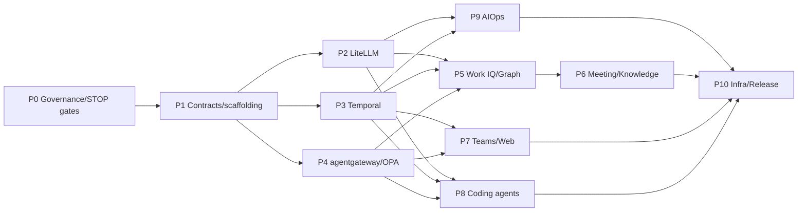

# Master Implementation Plan

## 1. 目的

既存`ai-ops-platform`を停止させる一括置換ではなく、現行機能を維持したまま、次の最終構成へ可逆的に移行する。

- Temporalによるdurable control plane
- LiteLLMによるBedrock/Anthropic統一推論
- agentgateway + OPAによる統制付きMCP/A2A
- Work IQ + GraphによるM365 intelligence/system integration分離
- OpenTag由来Teams UXと既存Next.js Workbench
- Wispr → review → Plane/GitHub/Confluence/SharePoint
- Claude Code/DroidのPR-only runner
- OpenTelemetry相関型AIOps

## 2. 実施原則

1. **Strangler migration**: 旧経路を保持し、shadow → limited → primary → old-path removalの順で移行する。
2. **No hidden dual-write**: 比較期間はdual-read/shadow-resultまで。二つの正本へ同じ意味を同時書込みしない。
3. **Contract first**: API、event、policy、model alias、tool risk contractを先に固定する。
4. **One Writer**: WBSのwriterのみがタスクbranchへ変更する。reviewerは独立検証する。
5. **Fail closed**: 不正設定、分類不明、OBO不成立、policy timeout、tool mismatchは拒否・保留する。
6. **Evidence before enablement**: 実環境証跡がないflagは本番で有効にしない。
7. **Preserve existing truth**: 既存仕様ID、決定的ロジック、監査、sanitizer、permission filterを再利用する。

## 3. Critical Path

## 4. Phase概要

| Phase | 主目的 | Production traffic | Exit authority |
|---|---|---:|---|
| P0 | baseline、branch protection、ADR、法務/ENV決定 | 変更なし | Owner + Security |
| P1 | contract、package scaffold、ledger、fitness gate | 変更なし | Architecture review |
| P2 | LiteLLM導入・全LLM consumer移行 | shadow→limited | Model gateway owner |
| P3 | Temporal workflow化 | shadow→canary | Operations owner |
| P4 | agentgateway/OPA | read-only pilot | Security owner |
| P5 | Work IQ delegated path + Graph分離 | limited users | M365 admin/security |
| P6 | Wispr/knowledge publication | pilot projects | Data owner |
| P7 | Teams/Web UX | pilot channels | Product owner |
| P8 | Claude/Droid runners | non-prod repos first | GitHub owner/security |
| P9 | AIOps correlation/incident | shadow RCA first | SRE/operations |
| P10 | Azure release/DR/go-live | canary→100% | Release board |

## 5. 依存順序

- P2/P3/P4はP1後に並行可能。ただし同じ共有ファイルへ同時変更しないよう、WBSのpath ownershipに従う。
- P5はLiteLLM/Temporal/OPAの最低契約が必要。
- P6/P7/P8/P9はControl APIとledgerが安定してから開始する。
- P10は各componentの実環境E2E、DR、security gateが完了するまでtraffic切替しない。

## 6. Owner Decision Gates

| Gate | Decision | Default pending decision |
|---|---|---|
| ENV-DEC-001 | Temporal Cloud vs AKS self-host | Temporal Cloud + Azure workers。ただし契約不可ならAKS profile |
| ENV-DEC-002 | CopilotKit Intelligence使用可否 | PoCで評価。不可なら自己管理Teams adapter |
| ENV-DEC-003 | Work IQ production scope | read/ask/fetch onlyから開始 |
| ENV-DEC-004 | Wispr permitted meeting classes | internal technical meetings onlyから開始 |
| ENV-DEC-005 | Anthropic direct allowed classifications | public/internal only。confidentialはBedrock only |
| ENV-DEC-006 | Confluence Cloud adoption | technical knowledge pilot space |
| ENV-DEC-007 | Droid production runner | disabled until pinned CLI + real E2E |

## 7. 変更を止める条件

- main branch protectionが無効、またはAI tokenがreviewを迂回できる。
- baselineの`mise run ci`が既に失敗しており、原因が未分類。
- provider/master secretがclient/runnerへ配布される設計。
- LiteLLMとagentgatewayの責務重複が発生。
- MCP high-risk toolが登録される。
- M365 user contextを失ったapp-only呼出しをWork IQへ行う。
- formal recordsがSharePoint以外へ自動正式化される。
- idempotency/approval version checkなしで副作用を実行する。
- 実テナント/実DB/実providerの証跡なしにproduction-readyと主張する。

## 8. 最終完了条件

1. WBS 110タスクの完了証跡または明示的なOwner-approved deferがある。
2. 全PRがspec/ADR/ACと実装・テストを相互参照する。
3. `mise run ci`、pack追加gate、実環境E2E、security、load、restore/DRがgreen。
4. 旧direct Anthropic path、旧in-process scheduler、未統制MCP pathがproductionから除去済み。
5. 1タスク1Writer、人間merge、no direct productionがGitHub/OPA/runnerで実効化される。
6. runbook、SLO、on-call、rollback、cost ownershipが引き継がれる。
