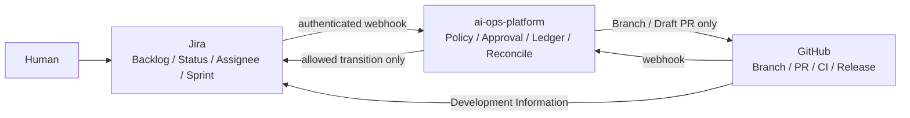

# Jira × GitHub governed integration 切替Runbook

- 対象: Jira Cloud、GitHub、ai-ops-platform
- Evidence: `JIRA-GH-GOV-001`
- ADR: [`docs/adr/0030-jira-github-governed-integration.md`](../docs/adr/0030-jira-github-governed-integration.md)
- Mapping fixture: [`docs/contracts/fixtures/jira-environment-mapping.dev.json`](../docs/contracts/fixtures/jira-environment-mapping.dev.json)

## 1. 完了条件

切替完了は、単にWebhookが202を返すことではない。次をすべて満たした時点とする。

- Jira Projectと`PJ-*`、GitHub repositoryのowner-signed mappingが承認済み
- Jira Status ID allowlistとprotected Status IDが実環境値で固定済み
- Jira Webhook認証がfail-closedで有効
- Jiraイベントが最小metadataだけで保存されることを確認済み
- `jira-sync` Workerが専用Task Queueで稼働
- shadow期間のWebhookとJQL Snapshotの差分が許容値内
- GitHubへの作成がDraft PRに限定されることを実証
- JiraからPR Approve/Mergeへ到達できないことを実証
- unknown writeとstaleの負例試験が合格
- rollback手順と担当者が承認済み

## 2. 正本と責務



Jira標準連携に任せてよいものはBranch、Commit、PR、Build、Deploymentの表示と非機密の定型Automationだけである。AIエージェント起動、重要Status、PR作成、Approval、Merge判断、Production判断、unknown resultの回復は`ai-ops-platform`へ残す。

## 3. 事前準備

### 3.1 Mappingを作る

開発fixtureをコピーし、実環境値へ置換する。

```bash
cp docs/contracts/fixtures/jira-environment-mapping.dev.json /secure/config/jira-environment-mapping.prod.json
```

本番Mappingでは以下を満たすこと。

- `environment=production`
- `signature`はowner署名済みBase64値
- `replace_before_go_live=false`
- `.invalid` hostを含まない
- Jira Cloud ID、Project ID、Project Keyが実値
- GitHub repositoryが`owner/repository`
- `allowed_status_ids`は全受理StatusのID
- `protected_status_ids`は承認なしで遷移させないStatusのID
- Sprintを利用する場合は正しい`customfield_*` ID

署名対象は、`provenance.signature`を除外して全object keyを再帰的に昇順へ並べたJSONのUTF-8 bytesである。
OwnerはEd25519秘密鍵でこのbytesを署名し、Base64署名を`provenance.signature`へ設定する。検証側には公開鍵を
PEMまたはbase64-SPKI形式で`JIRA_MAPPING_OWNER_PUBLIC_KEY`へ供給する。秘密鍵をserverへ配布しない。

検証する。

```bash
JIRA_MAPPING_OWNER_PUBLIC_KEY="$OWNER_ED25519_PUBLIC_KEY" \
  node scripts/validate-jira-environment-mapping.mjs /secure/config/jira-environment-mapping.prod.json
```

### 3.2 Webhook認証境界を準備する

`/webhooks/jira`を匿名公開しない。次のいずれかを採用する。

1. Jiraから認証済みAPI Gateway/Front Doorへ送信し、Gatewayが固定Bearerを付与する。
2. Jira Automationから管理済みSecretをBearerで送信する。
3. 組織標準の署名検証器を`JiraWebhookAuthenticator`として注入する。

認証器が未設定の場合、Endpointは503になる。無認証を許す暫定設定は禁止する。

server runtimeでは`JIRA_ENVIRONMENT_MAPPING_PATH`と`JIRA_WEBHOOK_BEARER_SECRET`を同時に設定する。
JQL snapshotを有効化する場合は、さらに`JIRA_SITE_BASE_URL`と`JIRA_OAUTH_ACCESS_TOKEN`を同時に設定する。
deployment compositionはADR-0030のTemporal `jira-sync` clientを`main()`の`dispatchJiraEvent`と
`commitCompleteSnapshot` DI seamへ注入しなければならない。Jira envだけを設定してbackendを注入しない構成は、
serverが起動時に拒否する。server packageへcontrol-plane/Temporal依存を追加してこの境界を迂回しない。

### 3.3 GitHub側の保護を確認する

- Default branchへの直接push禁止
- Required pull request review有効
- Required checks有効
- AI WriterとReviewerのidentity分離
- Jira/Atlassian接続identityによるPR自動Approveを無効化
- Jira StatusからMergeを実行するAutomationを無効化

## 4. 段階切替

### Phase 0: Deploy only

- `jira-sync` Workflow bundleとWorkerを配備する。
- Jira Webhookは認証済みだが、Workflow requestは`executionMode=shadow`にする。
- Plane Workerは継続する。Replay fixtureや`plane-sync` queueを削除しない。

### Phase 1: Shadow

最低1つの通常スプリント期間、次を比較する。

- Jira Webhook受信件数
- JQL SnapshotのIssue集合
- Status、Assignee、Sprint、`updated`、`fieldHash`
- GitHub PR/Build/DeploymentのDevelopment Information
- unmapped project、unknown Status、duplicate event、page token cycleの拒否件数

Shadowでは外部書込みを行わない。差分は監査ログへ記録し、原因をmapping、Webhook欠落、JQL条件、Status allowlistのいずれかへ分類する。

### Phase 2: Limited active

低リスクProjectを1件だけ`executionMode=active`へ切り替える。

許可する処理:

- GitHub Development InformationのJira投影
- Jira metadata eventの内部記録
- 明示承認後のGitHub Draft PR作成
- 明示承認後のallowlisted Jira transition

禁止する処理:

- PR Approve
- Ready for Merge化
- Merge
- mainへの直接push
- Production Approval
- Jira本文・コメント全文の同期

### Phase 3: Primary

全完了条件を満たしたProjectからJiraを運用正本へ切り替える。新規イベントをPlaneへ送らない。Planeは次だけに限定する。

- 過去Temporal history replay
- 監査上必要な参照
- rollback期間中のread-only比較

## 5. stale判定

保護書込みのbaselineは次の三要素である。

```text
updated + statusId + fieldHash
```

次のいずれかが異なれば`stale`として書込みを行わない。

- Jira更新日時が変わった
- Status IDが変わった
- Assignee/Sprint/対象FieldのHashが変わった

`stale`を自動上書きで解消しない。最新状態を再読し、ProposalとApprovalを再生成する。

## 6. unknown write result

非冪等書込みはone-shot/no-retryである。

1. Ledgerを読む。
2. `written`ならreceiptを回収する。
3. `pending`なら自動再送しない。
4. `absent`かつactiveなら1回だけ送る。
5. timeout/connection loss時はprovider readbackとLedgerを照合する。
6. 結果が確定しなければ手動reconcileへ送る。

HTTP 202/204の空本文は正常な成功応答として扱う。

## 7. JQL Snapshot reconcile

- 15分間隔を初期値とする。
- 全ページ完了時だけ`capture_complete=true`でcommitする。
- 同一Issueの重複、同一page tokenの再出現、上限超過、未知Statusを検知したSnapshotは破棄する。
- 部分Snapshotを前回の完全Snapshotへ上書きしない。
- WebhookとSnapshotの差分はIssue Key単位で監査する。

## 8. 緊急停止

次のいずれかが起きたらactive writeを停止し、shadowへ戻す。

- DraftでないPRが作成された
- Jira Status変更がApprovalなしで成功した
- Jira DoneからPR Approve/Mergeが実行された
- unknown Statusが受理された
- Webhook raw body、Description、Comment本文がevents/auditへ保存された
- Snapshotの部分取得が正本としてcommitされた
- `pending` Ledgerに対して自動再送された

停止順序:

1. `jira-sync` Writer Workerを停止し、Reader/Reconcile Workerだけ残す。
2. Jira Automationの書込みRuleを無効化する。
3. GitHub Appのwrite permissionを一時停止する。
4. Webhookは受信継続し、shadow queueへ記録する。
5. Ledger、Jira、GitHubをreadbackして影響範囲を確定する。

## 9. Rollback

- 新規Jira writeを停止する。
- Jiraをread-only運用にし、GitHubと監査Ledgerを基準に未確定処理を解消する。
- Planeへ新規イベントを戻す場合も、既存`plane-sync` replay用経路と新規入力を分け、同一Workflow IDを再利用しない。
- Mapping versionを増やし、旧versionのイベントを新versionへ混在させない。

## 10. 検証コマンド

```bash
node --test tests/validate-jira-environment-mapping.test.mjs
node scripts/validate-jira-environment-mapping.mjs docs/contracts/fixtures/jira-environment-mapping.dev.json
pnpm --filter @aiops/integrations test
pnpm --filter @aiops/control-plane test
pnpm --filter @aiops/server test
pnpm --filter @aiops/devops typecheck
pnpm run governance:check
```

依存パッケージを導入できない環境では、Mapping検証、JSON/YAML parse、TypeScript syntax checkを実施し、未実行の型検査・Vitest・E2Eをリリース判定へ明記する。
